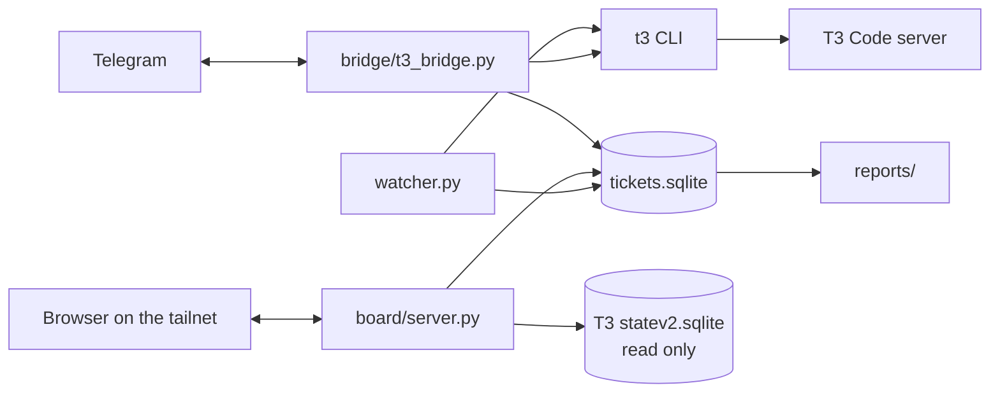
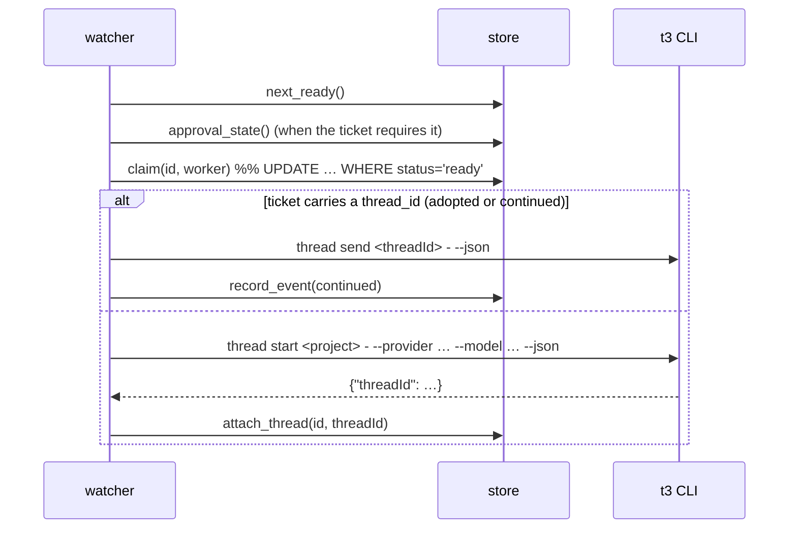
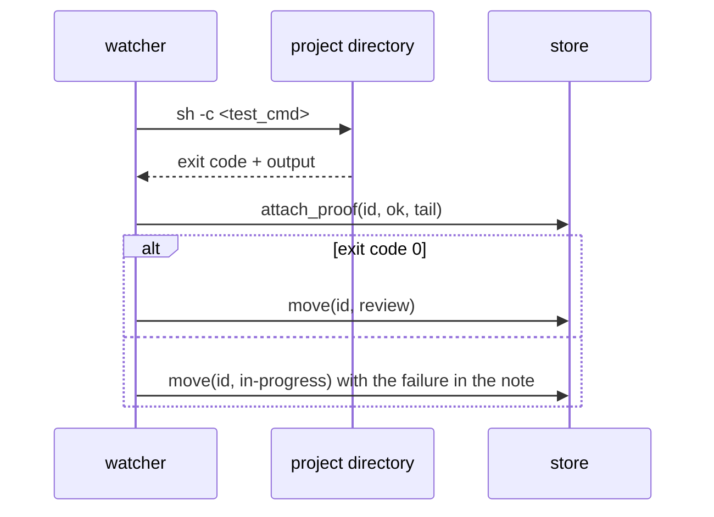
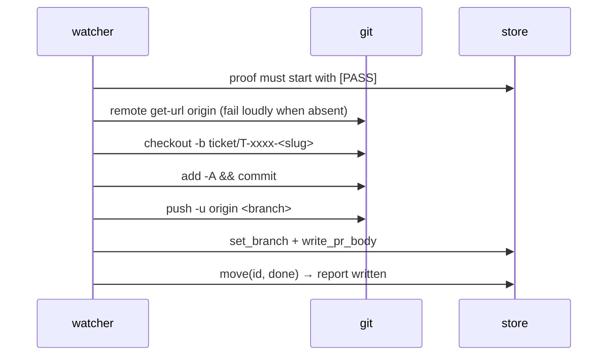

# Architecture

How the four pieces fit together, what each one owns, and where the boundaries are.

## Components



| Component | Owns | Never does |
|---|---|---|
| `tickets/store.py` | the state machine, atomic claim, approvals, proofs, reports | call T3 or the network |
| `watcher.py` | the dev, test, review and release stages | invent a model profile; push the base branch |
| `bridge/t3_bridge.py` | Telegram commands, audit log, approval notices | answer a T3 approval request itself |
| `board/server.py` + `index.html` | HTTP API and the single-page board | write a ticket outside `store.move`/`store.add` |
| `scripts/alert.py` | one Telegram alert per failing unit | retry, restart, or decide anything |

T3 remains the owner of projects, threads and runs. This repository reads `statev2.sqlite` for two things only: the project list and recent threads (both read-only, `mode=ro`).

## Data model

`tickets`

| Column | Type | Meaning |
|---|---|---|
| `id` | text | `T-0001`, assigned from the row count |
| `title`, `body` | text | what to do |
| `status` | text | one of the seven states |
| `priority` | integer | 1 (highest) … 5 |
| `project` | text | T3 project title or absolute path |
| `model_profile` | text | key into `config.models`; empty means `defaults.profile` |
| `test_cmd` | text | command the test stage runs in the project directory |
| `requires_approval` | integer | 0/1; 1 makes the dev stage wait for an approval |
| `thread_id` | text | T3 thread, filled by the dev stage or by adoption |
| `branch`, `pr_url` | text | filled by the release stage |
| `claimed_at`, `claimed_by` | text | set by the atomic claim |
| `proof` | text | exit status plus output tail from the test stage |
| `report_path`, `pr_body_path` | text | files written on completion |
| `verify_thread_id`, `verify_run_id` | text | the reviewer thread and run of the current attempt |
| `verify_provider`, `verify_model`, `verify_attempt` | text, integer | who reviews, and how many attempts were used |
| `verify_verdict`, `verify_findings` | text | `ACCEPT`/`REJECT`/`FAILED`/`TIMEOUT`, and the reviewer's words |
| `verify_started_at`, `verify_finished_at`, `verify_baseline` | text | budget, and the tree fingerprint the verdict belongs to |
| `dev_attempts`, `test_attempts` | integer | retry budgets: thread failures and failing tests |
| `dev_run_id` | text | resume anchor: the run the dev thread was on when findings were sent |
| `note` | text | last human or stage note |
| `created_at`, `updated_at` | text | ISO-8601 UTC |

`events` — append-only history: `created`, `moved`, `forced`, `claimed`, `thread`, `continued`, `proof`, `approval-requested`, `approval-decided`, `branch`, `report`, `pr-body`, `verify-started`, `verify-accept`, `verify-reject`, `verify-failed`, `verify-timeout`.

`approvals` — `approval_id`, `ticket_id`, `question`, `status` (`pending`/`approved`/`rejected`), `created_at`, `decided_at`, `decided_by`, `note`.

Migrations run on open (`MIGRATIONS` in `store.py`); a column is added with `alter table` when missing, so an older database keeps working.

## State machine

```
backlog  → ready, blocked
ready    → in-progress, backlog, blocked
in-progress → testing, ready, blocked
testing  → review, in-progress, blocked
review   → done, in-progress, blocked
blocked  → ready, backlog
done     → (terminal)
```

`store.move()` refuses anything else. `force=True` is the human override and is recorded as `forced` so the report distinguishes a decision from a transition. The watcher never forces: every stage move it makes is one of the allowed transitions above.

## Stages

### Dev stage



The claim is a single conditional `UPDATE`; a second worker gets `rowcount = 0` and reports the current status instead of starting a duplicate thread.

### Sync stage

Every loop starts by reconciling tickets with the threads they point at:

| Thread status | Ticket move |
|---|---|
| `completed`, `idle` | `testing` — the agent's work is done, now prove it |
| `failed`, `cancelled`, `interrupted` | `blocked` with the thread status in the note |
| `running`, `waiting`, unknown | left alone |

This is what makes adoption work: the agent finishes inside its own thread and the watcher advances
the ticket from that status rather than from a guess.

### Test stage



A ticket without `test_cmd` cannot advance: the stage records that fact and sends it back to `in-progress`.

### Retry and resume

A failure that a second attempt can plausibly fix goes back into the queue, counted on the ticket:

| Failure | Action | Limit |
|---|---|---|
| `thread start`/`send` raised or returned rc≠0, or its JSON was unusable | `in-progress → ready` with `retry` event | `retry.maxThreadAttempts` |
| Dev thread reported `failed`/`cancelled`/`interrupted`/`rolled_back` | same retry | `retry.maxThreadAttempts` |
| Test failed (or timed out) | output tail sent into the dev thread, `in-progress`, findings event | `retry.maxTestAttempts` |
| Test command empty | `blocked` (a retry cannot fix a missing command) | — |
| Dev thread failed with a permanent cause (usage limit, context overflow, removed model, provider mismatch) | `blocked` with the error message, no retry | — |

When findings are sent, the watcher stores the thread's current `latestRunId` as `dev_run_id`. The sync
stage refuses `completed`/`idle` → `testing` while the thread is still on that run, so the code that just
failed cannot be tested again before the agent has started working. A successful start or a passing test
resets both budgets (`reset_attempts`).

### Verification stage

`review` is where the work is judged before it is pushed. The stage starts a second thread — a fresh
context — and only a `VERDICT: ACCEPT` line lets `release()` run. It is not a new status: `review`
already exits to exactly `done`, `in-progress` or `blocked`.

```mermaid
sequenceDiagram
    participant W as watcher
    participant S as store
    participant G as git
    participant T as t3 CLI
    W->>G: git status --porcelain=v1 -uall ; git diff HEAD ; fingerprint
    W->>T: thread start <project> - --provider … --model … --json
    T-->>W: {"threadId": …, "runId": …}
    W->>S: attach_verifier(threadId, runId, provider, model, baseline)
    Note over S: ticket stays in review, verify_attempt += 1
    W->>T: thread show <reviewer> --json --messages 5
    alt last line is VERDICT: ACCEPT
        W->>S: record_verdict(ACCEPT)
        W->>G: release: branch + commit + push
    else VERDICT: REJECT and attempts left
        W->>T: thread send <dev thread> - (the findings)
        W->>S: record_verdict(REJECT) ; clear_verifier ; move(in-progress)
    else REJECT at max, no verdict, failure or timeout
        W->>S: move(blocked) with the reason in the note
    end
```

What the reviewer gets is built from the repository, not from the dev model's prose: the ticket row,
the recorded `proof`, `git status`, and `git diff HEAD`, capped by `verification.maxDiffBytes`. The
prompt tells it not to edit and to end with exactly one line, `VERDICT: ACCEPT` or `VERDICT: REJECT`.

Enforcement, in the order it happens:

| Check | Source | Consequence |
|---|---|---|
| A verdict exists | `parse_verdict()` | otherwise `blocked`, never a silent accept |
| The verdict is the runner's own line, not prose | one line that consists of the token only, after dropping list markers and markdown emphasis; contradicting lines are refused | prose is never read as a decision; a trailing `Skills:` line does not hide it |
| The verdict belongs to the verified run | reply message `runId` == `verify_run_id`, and `runCount == 1` | a stale or second run blocks the ticket |
| The reply is the reviewer's, not the prompt's | message `role == "assistant"` | a user message carrying the token cannot decide |
| The status is one this code knows | `thread show` → `completed`/`idle`; `failed`/`cancelled`/`interrupted`/`rolled_back` block; anything else blocks with its own note | a future status fails closed with the right reason |
| The project tree did not move during the review | `verify_baseline` fingerprint vs. now | `blocked`, the verdict is not evidence |
| The reviewer finished | `thread show` → `completed`/`idle` | `running` waits, `failed`/`cancelled` blocks |
| The review is inside its budget | `verify_started_at` + `verification.timeoutMinutes` | `blocked` |
| Attempts are bounded | `verify_attempt` vs. `verification.maxAttempts` | `blocked` with the last findings |

The reviewer's model is the owner's choice: by default the ticket's own selection (same harness, same
model, fresh context), or `verification.profile` when a different preset is wanted. `verification.enabled`
false restores the old behaviour: `review` releases directly.

A read-only runtime mode does not exist in T3 0.1.9, so "the reviewer cannot write" is enforced by the
fingerprint check rather than by a sandbox; see `docs/readonly-verifier.md` for the measurements.

### Release stage



The base branch is never pushed. `compare_url()` turns an HTTPS or SSH remote into a `…/compare/<base>...<branch>?expand=1` link; a local path yields no link.

## How the harness and model are chosen

```
ticket.provider + ticket.model      validated against ~/.t3/caches/<instanceId>.json
        ↓ if empty
ticket.model_profile (a preset)     from ~/.config/t3-workflow/config.json
        ↓ if empty
config.defaults.profile
```

The catalogue is T3's own provider cache: the same file the T3 UI reads, refreshed by the server
(`checkedAt`). A disabled harness or an unknown model is rejected when the ticket is created, so a
ticket cannot carry a choice that would fail later in the watcher.

Model options (`thinking`, `variant`, `effort`) are reported by the catalogue but **not applied**:
`t3 thread start` accepts `--provider` and `--model` only. The thread therefore uses the project's
default options. Applying per-ticket options would need a CLI flag that does not exist today.

## Concurrency and ordering

- `step()` drains `review` (verification first, then release), then `testing`, then `ready`; a waiting test never competes with a new thread.
- `watcher.maxConcurrent` counts `in-progress` tickets; above the limit the stage returns "waiting" and does nothing.
- `limits.maxInProgressMinutes` sweeps stale `in-progress` tickets to `blocked` at the start of each step.
- The bridge and the board share the same store file; SQLite's locking handles it, and the claim is the only place that needs atomicity.

## Failure behaviour

| Failure | Result |
|---|---|
| T3 CLI missing or failing | ticket moves to `blocked` with the exit code and output |
| Output of `thread start` is not JSON | ticket moves to `blocked`, no thread recorded |
| Test command missing or timing out | proof records it, ticket returns to `in-progress` |
| No git remote | release raises; the ticket stays in `review` |
| Non-passing proof | release raises; only a human override moves it |
| Reviewer rejects | findings go into the dev thread, one attempt is spent, the ticket returns to `in-progress` |
| No verdict, reviewer failed, timed out, or the tree changed | ticket moves to `blocked`; nothing is accepted silently |
| Unit crash | systemd restarts it (`Restart=on-failure`) and `OnFailure=` sends one Telegram alert |

## Why no daemon on the T3 side

The target of this tooling is the operator's machine, not a fleet. Every T3 interaction is a one-shot CLI call or a database read, which keeps the system readable and means a dead service never leaves a half-written state in T3: the worst case is a ticket that stays where it was.
